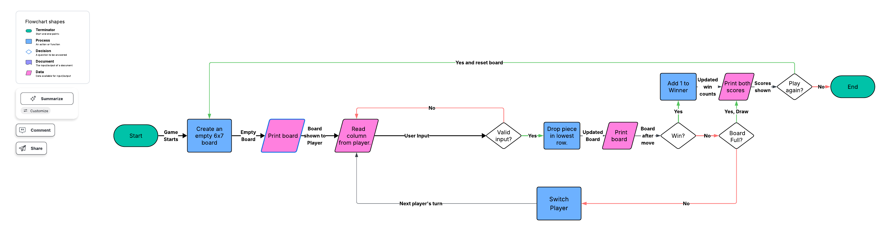

# Connect Four

A two-player Connect Four game in Java that runs in your terminal and tracks the number of wins that you have.

## The Problem

My friends and I play Connect Four a lot, and we constantly argue about who is better because nobody keeps track of how many times each person has won. Each of us says we are better than the others, but we have no way to prove it. I want to build a terminal game that we can play on a laptop which keeps track of the wins.

## How It Works

At the start, each player enters their name. Players take turns filling up the board by dropping pieces into the lowest empty row. After every move, the program checks for four in a row, which can be horizontal, vertical, or diagonal. It can also declare a draw if the board is full. After each game, it displays each player’s number of wins and asks if they want to keep playing. Players can also type "q" at any time to quit the game.

**Features**
- Two-player game with the ability to identify winners.
- Do not crash or accept invalid input.
- Win counter for each player.
- Show the score for each player.
- Play again option.
- Player names.
- Quit anytime.



[Eisenhower Matrix](EisenhowerMatrix.pdf)

## Tech Stack

- **Language:** Java
- **Libraries:** Uses IO.readln to read input, IO.println to write output, Integer.parseInt to convert Strings to numbers, and .equals to compare pieces.
- **Tools:** Uses IntelliJ to write and run the code.
- **Data storage:** The board is stored in a 6 by 7 String array, and the win counts are stored as ints.
- This project does not pull any data from the internet, and it runs in the terminal.

## Setup
This game requires **Java JDK 25 or newer** (the code uses `void main()` and the `IO` class).
Check your version with `java --version`. Download it from https://adoptium.net if needed.
```bash
git clone https://github.com/tejasraj03262/Connect-Four
cd Connect-Four
java src/ConnectFour.java
```

## Usage
Run the game:

```bash
java src/ConnectFour.java
```


1. Each player enters their name (or presses Enter to use "Player 1" / "Player 2").
2. Players take turns typing a column number (1-7) and pressing Enter.
3. Type "q" to quit anytime.
4. After each game, the score is shown and you can type 'y' to play again or 'n' to stop.

### Example

```
Welcome to Connect Four!
Player 1 (X), enter your name:
Tejas
Player 2 (O), enter your name:
Bob
1 2 3 4 5 6 7
. . . . . . .
. . . . . . .
. . . . . . .
. . . . . . .
. . . . . . .
. . . . . . .
Tejas (X) - Choose a column (or q to quit):
1
1 2 3 4 5 6 7
. . . . . . .
. . . . . . .
. . . . . . .
. . . . . . .
. . . . . . .
X . . . . . .
...
Tejas (X) - Choose a column (or q to quit):

That is not a number
Tejas (X) - Choose a column (or q to quit):
4
...
Bob (O) - Choose a column (or q to quit):
2
1 2 3 4 5 6 7
. . . . . . .
. . . . . . .
O . . . O . .
X O X X O . .
X O O X X . .
X O X O X O .
Bob Wins!
Score - Tejas: 0 | Bob: 1
Play again? (y/n)
n
Thanks for playing!
```
## Roadmap

- [x] Set up GitHub and the README.
- [x] Create a 6x7 board and write a method to display it.
- [x] Write a method to check that the chosen column is valid and not full, and handle invalid choices.
- [x] Write a method to find which row to drop the piece in.
- [x] Make sure the game switches between players.
- [x] Write a method that checks for horizontal, vertical, and diagonal wins or draw.
- [x] Write a play-again option.
- [x] Add win counters and display score.
- [x] Take in each player's name.
- [x] Quit anytime.
- [x] Show final scores when players stop playing.

## Demo

[Video walkthrough](PASTE-YOUR-VIDEO-LINK-HERE)

## Author

Tejas Rajulapudi https://github.com/tejasraj03262