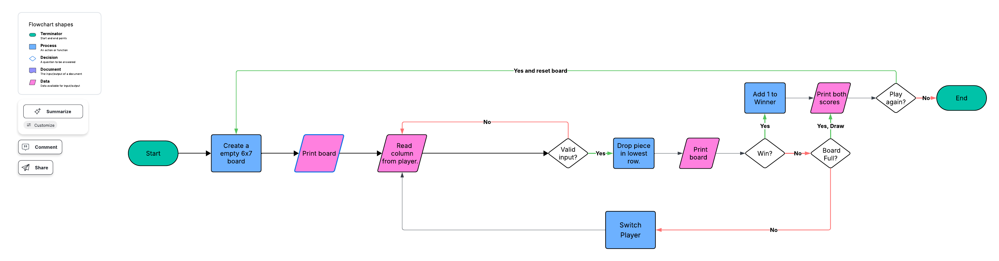

# Connect Four

A two-player Connect Four game in Java that runs in your terminal and tracks the number of wins that you have.

## The Problem

My friends and I play Connect Four a lot, and we constantly argue about who is better because nobody keeps track of how many times each person has won. Each of us says we are better than the others, but we have no way to prove it. I want to build a terminal game that we can play on a laptop which keeps track of the wins.

## How It Works

Players take turns filling up the board by dropping pieces into the lowest row. After every move, the program checks for four in a row. This can be done horizontally, vertically or even diagonally. It can also declare a draw if the game board is full.

**Features of the MVP**
- Two-player game with the ability to identify winners.
- Do not crash or accept invalid input.
- Win counter for each player.
- Show the score for each player.
- Play again option.



[Eisenhower Matrix](docs/EisenhowerMatrix.pdf)

## Tech Stack

- **Language:** Java
- **Libraries:** I will use IO.readln to read input, IO.println to write output, Integer.parseInt to convert Strings to numbers, and .equals to compare pieces. I will use IntelliJ to write and run the code. This project does not need to pull any data from the internet, and it runs in the terminal. The board is stored in a 6 by 7 String array, and the win counts are stored as ints.

## Setup

```bash
git clone https://github.com/tejasraj03262/Connect-Four
cd Connect-Four
```

## Usage

```bash
java src/ConnectFour.java
```

Players take turns typing a column number (1-7) and pressing Enter.

## Roadmap

- [ ] Take in each player's name.
- [ ] Print instructions at the beginning of the game.
- [ ] Quit anytime.
- [ ] Show final scores when players stop playing.

## Author

Tejas Rajulapudi https://github.com/tejasraj03262